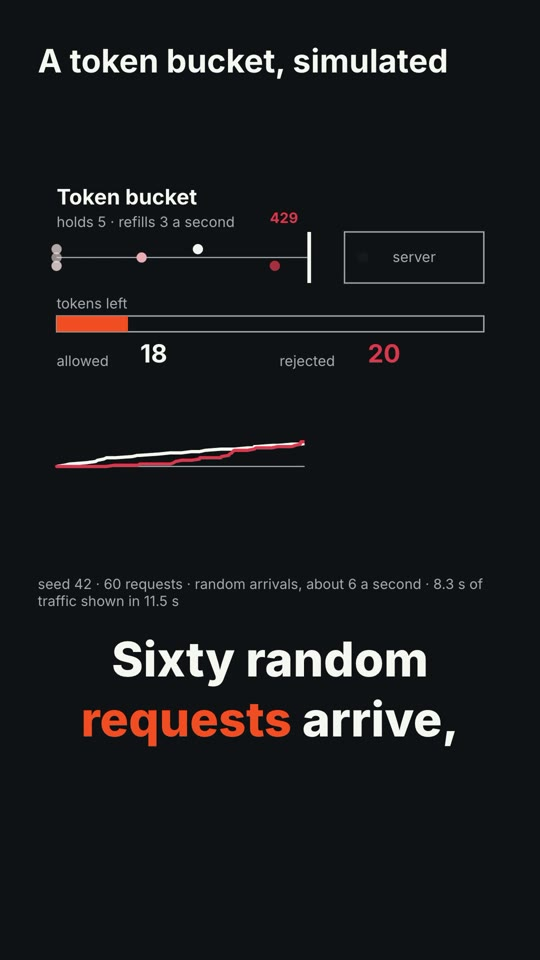
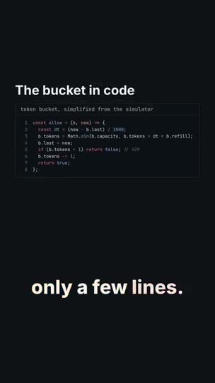
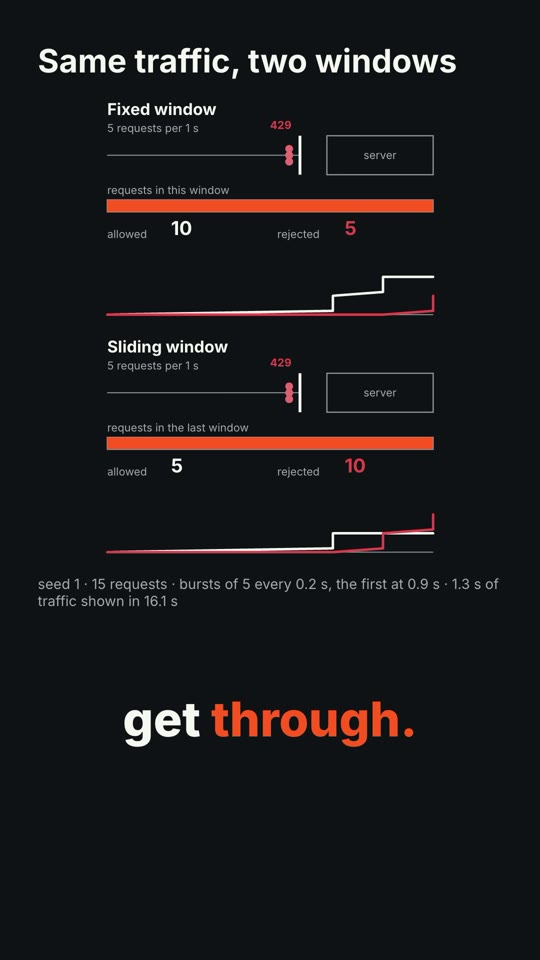
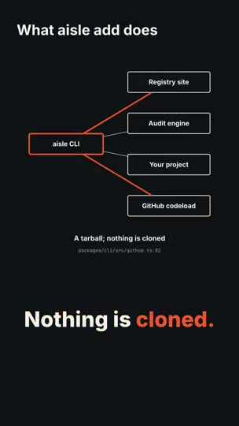
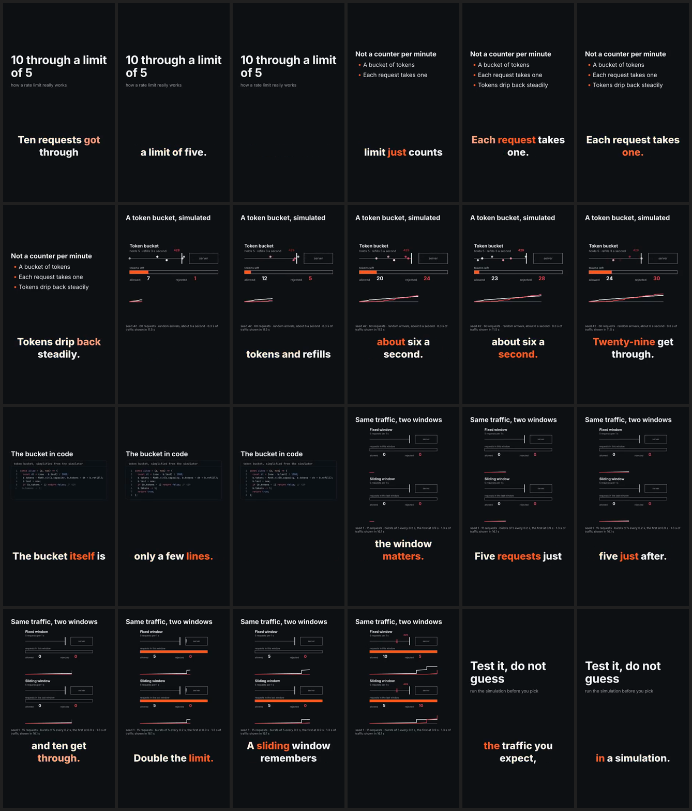
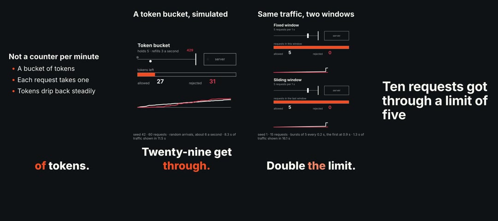

# Agent Aisle video library: user guide (draft, M6)

This is a draft. In this version you can set up a studio folder, write a script and storyboard, add animated diagrams and code scenes, make a voice track and captions, render a video and have it checked automatically, edit footage you already have, prepare a video for posting, and measure how a reference video is paced. Kids' cartoons with original puppet characters and app showcases are in too. Story videos and uploading come in later versions or never: nothing here uploads for you. `/video explain "<topic>"` walks an explainer through all of it.

## 1. Where it runs

Video needs real programs on your computer (FFmpeg, Node, a headless browser), so use **Claude Code on your own machine**:

- The Claude desktop app, **Code** tab, **Local** environment, with your studio folder open. The Cloud environment cannot see your folders.
- Or Claude Code in a terminal or VS Code, started in the studio folder.

Claude chat with an uploaded skill runs in a cloud sandbox and cannot render. (`TODO(verify)` sandbox limits.)

## 2. One-time install (about 15 minutes)

1. Install the tools. HyperFrames needs **Node 22 or newer**.
   - macOS: `brew install node ffmpeg python`
   - Windows: `winget install OpenJS.NodeJS.LTS Gyan.FFmpeg Python.Python.3.12`
   - Linux: your package manager.
     (`TODO(verify)` package names and versions.)
2. Install the renderer at the tested version: `npm install --global hyperframes@0.8.226`
3. Install the skills: `aisle add video` and `aisle add video-core` in the studio folder, or with `--global` for every folder.

## 3. Create the studio

Open any empty folder (for example `Documents/AisleVideos`) and type `/video init`. It creates `brand/`, `characters/`, `recipes/`, `library/`, `inbox/`, `projects/`, `exports/`, a `CLAUDE.md` with your defaults, `brand/brand.json` and `providers.yaml`. You never create folders by hand. Running it again changes nothing that exists, so it is safe.

Then type `/video doctor`. It lists what is installed, your hardware tier (not ready, $0 laptop, local GPU) and one install line for anything missing. It only says "found" or "missing" for API keys and never shows them.

## 4. Make a video

Each step is a command; each reads the files of the one before, so you can stop and edit between steps. A project is a folder `projects/<slug>/`.

1. **Write** (`/video-write explain "how rate limiting works"`). It writes `brief.json`, `script.md` (one `[id] line` per sentence with a `beat:`), `facts.md` (a source for every technical claim), `hooks.md` (5 openings) and `storyboard.md`. A checker runs and lists errors, such as a claim with no source or a missing beat. Read the storyboard, change what you want, then say go: it writes `video.json`. Only the `explain` and `story` modes exist. Scene kinds: `title`, `quote`, `list`, `chart`, `broll`, and for technical steps `rate-limit`, `code`, `sequence` and `request-flow` (step 2).
2. **Diagram scenes** (`/video-explain`). Fills the technical scenes with real data, never hand-drawn numbers. A `rate-limit` scene runs the actual algorithm (token bucket, leaky bucket, fixed window or sliding window) on seeded traffic and draws what happened; `simulate.mjs` prints the numbers the narration may quote. A `request-flow` scene is imported from an `arch-visualize` model (`docs/architecture.json`): the packets travel the connections of one flow and each step shows the `file:line` it came from. `code` scenes show real code with focus and diff; `sequence` scenes draw a message exchange from a few lines of text. See "Diagram scenes" below.
3. **Voice** (`/video-voice`). English uses Kokoro, Arabic uses 3arab-TTS, both on your own computer. `--provider test` makes a plain tone instead of speech, which is enough to check timing. Lines you did not change are kept, so re-running is cheap. Nothing can clone a voice, and a clone request is refused without consent.
4. **Lengths**: `timing.mjs` sets each scene's length from the audio.
5. **Word times and captions** (`/video-captions --style karaoke`). With whisper.cpp set up the word times are measured; without it they are estimated, and the tool says so in capital letters. Three styles: `karaoke`, `pop`, `clean`. You also get `captions.srt` and `captions.vtt`.
6. **Brand** (`/video-brand init`, `/video-brand check`): colours, a font and a logo for every video. Colours that are hard to read are refused. For Arabic put an Arabic font in `brand/fonts/`.
7. **Render**: a 540p draft first (`--draft`), look at it, then the final. Captions are burned in unless you chose subtitle files only; scenes keep clear of them. The sound is brought to about -14 LUFS.
8. **Credits**: `credits.json` and `CREDITS.txt`, with the disclosure advice.
9. **Check** (`/video-qa`). Measures the render and writes `qa/report.json` and a contact sheet (`qa/contact-sheet.png`), one picture per scene plus one every 2 seconds. See "The check" below.

The same project and assets always give the same video, byte for byte.

### Setting up voices and captions (once)

`/video doctor` shows which of these are ready. None are required: without them you can still use the test tone and estimated captions.

- Kokoro (English voice) needs Python 3.10 to 3.12 and about 1.5 GB for the libraries plus 350 MB of weights.
- whisper.cpp with the `base` model (150 MB) gives measured word times. On one test, 83% of words were within 100 ms of the reference and the median error was 35 ms; estimated times were within 100 ms for 35% of words.
- 3arab-TTS (Arabic voice) is about 1 GB of model plus libraries and runs slowly on a CPU.
- The exact steps, versions and the measured numbers are in `registry/official/video-voice/references/engines.md`. Voices are machine voices; Arabic text and speech are a draft that a native speaker should review before you publish.

10. **Publish** (`/video-publish --platforms shorts,reels,tiktok`). Prepares one folder per platform. See "Publishing" below.

### Diagram scenes

   

- **Rate limit.** `node video-explain/scripts/simulate.mjs --seed 42 --count 60 --pattern poisson --rate 6 --algo token-bucket --capacity 5 --refill 3 --into projects/<slug>/video.json --scene s3`. The footer of the scene says how much real time is shown in how many seconds; do not narrate it as real time. The same seed gives the same video. Say "in this simulation", and do not claim one algorithm is better in general from one seed.
- **Request flow.** Run `/arch-visualize` on your project first. `arch-import.mjs --list` shows the flows; `--flow <id> --into ... --scene <id>` fills the scene with only the components the flow touches. It shows what the code says, not live traffic, and it has no timings.
- **Code.** At most 20 lines of 60 characters. The panel is always dark. The colours come from a bundled highlighter (Shiki, MIT) and nothing is downloaded.
- **Sequence.** `A->B: text` for a request, `B-->A: text` for a reply, `Note over A,B: text`. A subset of Mermaid sequence diagrams also works.

### The check

`/video-qa` fails the video on: a wrong size, frame rate or codec; sound that is silent, far from -14 LUFS or clipping; a black stretch; more than 3 flashes in a second; anything drawn in the outer margins; captions too small or low in contrast; a narration line with no voice; a missing licence; a leftover `TODO` or `[needs-source]`. It warns when nothing changes for 3 seconds. It does not check spelling, platform user-interface margins or the truth of the content, and the loudness target and margins are working defaults, not confirmed platform rules (`TODO(verify)`).

### Editing footage

`/video-edit` works on files you already have (a screen recording, a talking clip). Each command reads the original and writes a new file; the original is never changed.

- `cut` tightens a talking clip: it shrinks long pauses and takes out "um"s (Arabic fillers too). It is a dry run first and prints what it would remove; add `--apply --out tight.mp4` to render it. On the rate-limit demo it found 16 pauses worth 11 seconds. Without whisper.cpp use `--silence-only`.
- `reframe` turns 16:9 into 9:16. With OpenCV installed (`/video doctor` says) it follows the speaker's face; otherwise use `--mode center|left|right|x=0.4`. It tells you how often a face was found, and it can miss profiles and several people.
- `audio` brings the sound to -14 LUFS without squashing it (two passes), with optional `--denoise` and music under the voice. `color` has three looks (warm, cool, film), your own `.cube` LUT, and an automatic white balance. `stabilize`, `jumpcut` (eased zooms at times you give), `trim`, `join`, `speed`, `gif` and `scenes` are there too.

### Showcase: a demo of your own app

`/video-showcase` turns a short demo script into a polished screen demo. You write `demo.md` (one step a line: `go /`, `click "Start free trial"`, `type #email "me@example.com"`, `scroll down 600`, `wait 1`; the agent can draft it, you approve it). `capture.mjs` plays it on your app in a headless browser and records the screen plus an interaction log of every click, keystroke and scroll. `plan.mjs` then cuts waiting over 1.2 seconds, plays typing three times faster, eases a camera in on each click, draws a smooth cursor with a click ripple, and puts the recording in an original, generic phone, laptop or browser frame (a `screen` scene). `beats.mjs --audio track --snap` finds the beat of a music track (60 to 180 BPM) and moves scene cuts to the nearest beat.

One-time setup for capture (you run this yourself; the skills never install anything): `npm install --prefix ~/.aisle-video playwright-core`, plus a Chromium it can start (`/video doctor` shows a `playwright` line). Without it, record your screen yourself and give `plan.mjs` a log.

What it will not do: record a site that is not yours (localhost only, or `--own-site --rights "why"`; requests to other addresses are blocked while recording), type into password, card or key fields, or record a native desktop app. The cursor is drawn from the log, not recorded, and the camera follows the log, not what is on screen. Beat detection can be wrong on complex music, so check by ear.

### Kids: cartoons with original characters

`/video kids "Nour the turtle learns to share" --age 3-5` makes a short cartoon for children from original puppet characters. Nothing here uses pictures made by AI, and nothing is generated by a paid service.

1. **A character** (`/video-kids new-character`). You say a name, a kind of creature, one sentence of personality, a shape (`round`, `square` or `triangle`) and 3 to 5 colours. The agent writes `characters/<name>/bible.md`, checks it, then draws a shaded, rounded SVG puppet from it (a pseudo-3D illustration look, not a 3D model) (`puppet.json`) and a contact sheet, `sheet.svg`. **Open `sheet.svg` in a browser** to see the character with each mouth shape and a blink; say yes, or ask for changes. The puppet is data (head, eyes, brows, eight mouth shapes, arms, legs, pivots), so it is easy to change, and you can bring your own SVG parts (they are checked: shapes only, no scripts or links).
2. **The story** (`/video-write kids`). One learning goal, an age band (`kids-3-5` or `kids-6-9`) that sets the sentence length and pace, a repeated pattern, a kind tone, no scary peril. It never asks children to like, subscribe or follow. You approve the storyboard before anything is made.
3. **Voice and lips.** `video-voice` speaks the lines (slowly: about two words a second for ages 3 to 5). Kokoro has only adult voices, so `kidvoice.mjs` raises each character's pitch (and its formants) by the `Voice pitch` in the bible: it sounds younger, but it is **not a real child's voice**, and this library never clones a child's voice. Then `video-kids` turns the words into mouth shapes; the mouth closes where the recording is quiet. If whisper.cpp could not align the words (it needs ffmpeg), the mouths are approximate and the output says so.
4. **Acting.** Each `puppet` scene has a backdrop (`meadow`, `room` or `night`) and up to four characters that walk, wave, jump, nod, dance and show moods (happy, sad, surprised, sleepy). They blink by themselves.
5. **Checks.** `video-qa` adds the kids' checks: pace, sentence length, no pressure phrases, gentle words, scenes of at least three seconds, captions at least 6% of the height (the `kids` caption style is 6.5%), stricter flashing (2 a second) and contrast (7:1), and a bible for every character. All of these numbers are working defaults, not platform rules (`TODO(verify)`). They cannot judge whether a story is good for a child: you read it.
6. **Publishing.** The pack says "made for kids: yes". You answer on the platform yourself; nothing is uploaded.

**Originality.** Characters must be original. The bible check refuses the names of well-known characters, but it cannot know them all: never ask for a character that looks like a famous one, and never use a real child's photo. The library will say no and offer an original.

Demo: [`docs/video/demos/kids/`](demos/kids) holds "Nour learns to share" (two characters, three scenes, about 31 seconds): the MP4, its sources and its QA report.

### Publishing

`/video-publish` needs a final render, a passing check and `credits.json`. You (or the agent) write `publish/copy.json` with a title, description and hashtags; the tool checks it against each platform's limits and refuses any number that is not in your script or facts. Per platform you get the encoded video, three thumbnails and a designed title card, the checked text (with YouTube chapters made from your scenes), captions, credits, a `disclosure.md` with the questions to answer on the platform (including "made for kids"), and `exports/publish.json` with file hashes. It never uploads. The platform limits are unverified (third-party sources disagree, and the smaller limit is used); check each platform's own page before relying on them.

### Learning a format

`/video-analyze <file> --name my-format --rights own|permission|cc|public-domain` measures how a video you have the right to use is made: cuts a minute, shot length, hook length, how much moves and how much is speech, five colours and a (rough) tempo guess. It writes `recipes/my-format.json` with numbers only. It never keeps or reuses the footage, sound, words or characters, and it does not measure text on screen or caption style. The rights you state are recorded, not verified.

## 5. Troubleshooting

- **"FFmpeg not found"**: run `/video doctor`.
- **`reframe` says no face was found**: OpenCV may not be installed (`/video doctor`), or the face is small or sideways. Use `--mode center`, `left`, `right` or `x=0.4`.
- **`/video-publish` refuses**: read each `REFUSED` line; it names the missing QA, credits or copy, the wrong shape for the platform, or a number that is not in your script.
- **"HyperFrames is not installed"**: run the install line it prints.
- **A code scene looks different on another computer**: it uses that computer's monospace font; the colours and layout are the same.
- **`/video-qa` says "could not run video-core checks"**: install `video-core` next to `video-qa` in the same skills folder.
- **A QA failure on loudness or clipping after you changed the voice**: render again; the mix is rebalanced at render time.
- **Arabic letters look wrong or missing**: put an Arabic font (for example Cairo, OFL licence) in `brand/fonts/` and point `meta.brand` at your `brand.json`; `/video-brand check --lang ar` tells you if none is there.
- **Captions drift from the voice**: the word times were estimated. Set up whisper.cpp (see the setup notes above) and run the voice step's alignment again.
- **"kokoro is not installed"**: run `/video doctor`; use `--provider test` meanwhile.
- **A render is slow**: use `--draft` while you edit.
- **Disk is full**: delete `projects/*/out/` and `projects/*/cache/`.

## 6. Costs

Everything in this version is local and free. Paid AI generation does not exist yet; when it arrives it will ask before spending and keep a log in `projects/<slug>/spend.json`.

## 7. Rights and labels, in plain words

- Every asset needs a licence in `video.json`, or the build fails. Music and sound effects need one too.
- Use only original characters, music and logos, or ones you hold a licence for. No real person's voice or likeness without their consent.
- Disclosure advice (the "altered or synthetic content" label, kids' content) is worked out from your assets and printed in `CREDITS.txt`. Platform rules change; check the platform's own help page before publishing (`TODO(verify)`).
- Nothing is ever uploaded for you.
